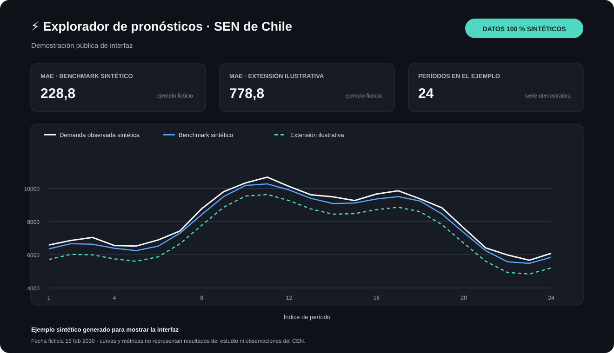

# Pronóstico de demanda eléctrica del SEN de Chile

**Python · Series temporales · Validación cronológica · scikit-learn · Streamlit · Plotly**

Proyecto aplicado de Data Science para estudiar el pronóstico horario de demanda sistémica agregada del Sistema Eléctrico Nacional (SEN). La pregunta fue si una regla de calendario sencilla podía mejorar un benchmark basado en perfiles históricos por día de semana e índice de período.

## Resultado principal

En la evaluación retrospectiva de 2025, la extensión de feriados redujo el MAE de **488,96 a 479,91** (**−1,85 %**) frente al benchmark semanal, sobre **8.760 períodos**.

| Método | MAE | Cobertura |
| --- | ---: | ---: |
| Benchmark semanal | 488,96 | 8.760 períodos |
| Benchmark + perfil de feriados | 479,91 | 8.760 períodos |
| Cambio observado | −9,05 (−1,85 %) | La regla modificó 288 períodos |

Estas cifras son resúmenes agregados derivados de una evaluación histórica. No se distribuyen aquí las observaciones del CEN ni los pares de demanda observada y predicción. La evaluación no fue completamente ciega: el resultado del benchmark de 2025 ya se conocía antes de evaluar la extensión.

## Hallazgos principales

- **La regla añadida fue concreta y auditable:** para feriados nacionales de lunes a viernes, sustituyó el perfil habitual por el perfil histórico de domingo del mismo índice de período. Los demás pronósticos permanecieron iguales.
- **El beneficio fue desigual:** nueve de los doce feriados tratados mejoraron y tres empeoraron. La mejora observada en 2025 no demuestra estabilidad entre años.
- **La complejidad no garantizó menor error:** las especificaciones Ridge y de árboles potenciados probadas durante el desarrollo de 2024 no superaron al benchmark en esa ventana.
- **Los eventos extraordinarios siguen siendo una limitación:** la regla de feriados no cambia los pronósticos de perturbaciones de la red. El resultado no demuestra utilidad operacional.

## Cómo funciona la comparación

El **benchmark** estima cada período del día siguiente con el promedio histórico de la combinación correspondiente de día de semana e índice de período. La **extensión** aplica esa misma referencia y, únicamente en feriados nacionales que caen entre lunes y viernes, utiliza el perfil promedio de domingo para el índice correspondiente. Ambas reglas se compararon sobre los mismos objetivos.

El trabajo incluyó exploración y auditoría de series horarias de 2024 y 2025, validación cronológica, comparación de métodos, análisis de errores y una demostración interactiva. La demanda utilizada fue retrospectiva; no se reconstruyeron las versiones que habrían estado disponibles al momento histórico de cada emisión. Por eso, la evaluación no equivale a una simulación operacional.

Lee el [caso de estudio](docs/caso-de-estudio.md) para ver el protocolo, la regla de feriados, el flujo de investigación y los límites en un solo recorrido.

## Demostración visual

La aplicación pública usa **datos 100 % sintéticos** generados en memoria. La siguiente ilustración estática representa una vista de demostración; no es una captura de la evaluación real y sus curvas, fecha y métricas no corresponden a observaciones del CEN.



Para recorrer las cuatro vistas localmente:

```powershell
uv sync --locked --extra dashboard
uv run --locked --extra dashboard streamlit run dashboard/app.py
```

Requiere Python 3.11 o superior y [uv](https://docs.astral.sh/uv/).

## Tecnologías y reproducibilidad

- **Análisis y modelos:** Python, pandas, NumPy y scikit-learn.
- **Visualización interactiva:** Streamlit y Plotly.
- **Calidad:** unittest, Ruff y GitHub Actions.
- **Pruebas públicas:** usan ejemplos sintéticos y verifican que el paquete público no incorpore los artefactos históricos reservados.

La aplicación no accede a la API del CEN ni a archivos privados. Los scripts científicos se publican para inspección metodológica; algunos necesitan artefactos privados que no forman parte de esta distribución. La evaluación numérica histórica está archivada y no debe relanzarse como una nueva corrida desde este paquete. La reproducción de sus métricas requiere acceso legítimo a los datos de origen.

La integración continua ejecuta las comprobaciones públicas en cada `push` y `pull request`:

```powershell
uv sync --locked --extra dashboard --extra modeling --extra dev
uv run --locked --no-sync python -B -m unittest discover -s tests -p 'test_*.py' -v
uv run --locked --no-sync ruff check dashboard tests scripts
uv run --locked --no-sync python scripts/verify_public_tree.py
```

## Documentación

- [Caso de estudio](docs/caso-de-estudio.md)
- [Protocolo experimental](docs/protocol/README.md)
- [Código fuente](src/)
- [Dashboard y ejecución local](dashboard/README.md)
- [Pruebas](tests/)
- [Política de datos y procedencia](data/README.md)
- [Flujo de integración continua](.github/workflows/public-package-checks.yml)

## Fuentes, datos y licencias

La fuente de demanda fue el [Coordinador Eléctrico Nacional](https://www.coordinador.cl/). Los datos originales y los materiales de terceros están excluidos de las licencias de este proyecto; su publicación no implica que sean de dominio público ni confirma derechos de redistribución. Las métricas históricas resumidas se presentan con atribución, sin que ello resuelva la incertidumbre sobre las condiciones aplicables a los datos fuente.

El código original se distribuye bajo [MIT](LICENSE) y la documentación original bajo [CC BY 4.0](LICENSE-DOCS.md). Esas licencias no cubren datos ni materiales de terceros.

Este proyecto es independiente y no representa una herramienta operacional ni una publicación oficial del CEN.
