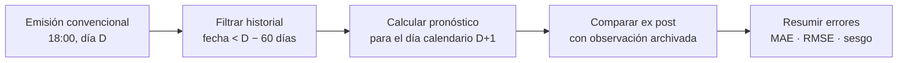
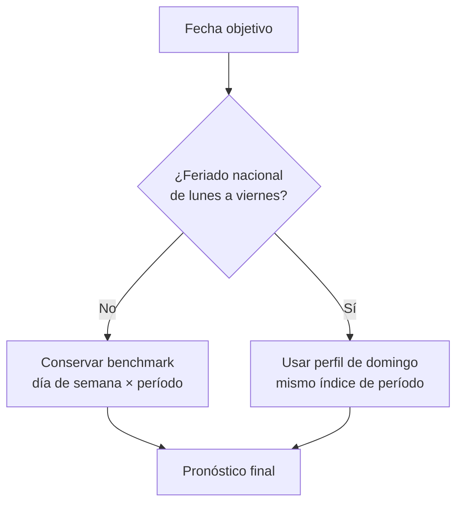
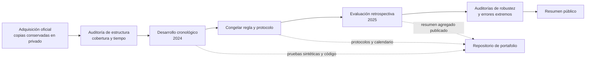

# Caso de estudio: pronóstico de demanda del SEN

Este caso de estudio resume la pregunta, el protocolo y los hallazgos principales del proyecto sin publicar las observaciones horarias del Coordinador Eléctrico Nacional (CEN), los pares de observación y pronóstico ni los archivos que permiten reconstruirlos.

## Pregunta

¿Una regla sencilla basada en el calendario puede mejorar una referencia estadística para pronosticar los períodos de demanda sistémica agregada del día calendario siguiente?

## Diseño de evaluación

La emisión diaria a las 18:00 de Chile continental es una convención experimental. Se pronostican los períodos que la fuente asigna al día calendario siguiente. Cada período se identifica por la fecha y el índice horario original; no se transforma a hora civil ni se rellenan períodos en los cambios de hora.

Para el escenario principal, solo se admite historial de demanda con una fecha anterior a la fecha de emisión menos 60 días calendario. El corte conservador limita el uso de valores recientes cuya disponibilidad histórica no se puede reconstruir. La fuente actual tampoco acredita qué versión exacta de cada valor se habría conocido en cada emisión.

El desarrollo y la evaluación se mantuvieron separados cronológicamente. El benchmark de 2025 utiliza un conjunto histórico fijo de 2024, elegible hasta el 31 de octubre; no se incorporan nuevas observaciones de 2025 para actualizarlo.

## Métodos comparados

### Benchmark semanal

Para cada período del día objetivo, el benchmark calcula una media histórica según la combinación de día de semana e índice de período. Usa una jerarquía de respaldo definida en el protocolo cuando un grupo no alcanza el soporte mínimo. Este es el punto de comparación para las extensiones.

### Extensión para feriados

En feriados nacionales que caen de lunes a viernes, la extensión reemplaza el perfil habitual por el perfil histórico de domingo para el mismo índice de período. En las demás fechas mantiene intacto el pronóstico del benchmark. Es una regla de sustitución, no un modelo entrenado para estimar un efecto causal del feriado.

## Resultado agregado publicado

En la evaluación retrospectiva de 2025, los dos métodos cubrieron 8.760 períodos. El resumen publicado es:

| Método | MAE |
| --- | ---: |
| Benchmark semanal | 488,96 |
| Benchmark + perfil de feriados | 479,91 |
| Cambio observado | −1,85 % |

La regla modificó 288 períodos correspondientes a doce feriados hábiles: nueve fechas mejoraron y tres empeoraron. El resultado es una mejora observada en ese año; no demuestra que el beneficio sea estable en años futuros.

Durante el desarrollo de 2024, las especificaciones Ridge y de árboles potenciados probadas no superaron al benchmark en la ventana de validación utilizada. Por ese motivo no se evaluaron en 2025; sus resultados no deben interpretarse como comparaciones fuera de muestra.

### Desarrollo 2024: métodos probados

| Método | MAE de desarrollo 2024 | Estado |
| --- | ---: | --- |
| Benchmark semanal | 447,16 | Referencia |
| Ridge estacional | 683,16 | No superó al benchmark; no evaluado en 2025 |
| Árboles potenciados | 567,48 | No superaron al benchmark; no evaluados en 2025 |
| Benchmark + perfil de feriados | 421,05 | Extensión seleccionada para una evaluación única en 2025 |

Estos son resultados de desarrollo, obtenidos durante la formulación y selección de métodos con 2024. No son estimaciones independientes del rendimiento futuro.

### Evaluación 2025: métricas agregadas

| Métrica | Benchmark semanal | Extensión de feriados |
| --- | ---: | ---: |
| MAE | 488,96 | 479,91 |
| RMSE | 692,79 | 680,59 |
| Sesgo (`pronóstico − observado`) | −8,87 | −36,37 |
| Períodos evaluados | 8.760 | 8.760 |

El MAE y el RMSE bajaron; el sesgo se hizo más negativo, es decir, aumentó la subestimación neta. La escala numérica se conserva como la entrega la fuente, sin asignarle una unidad física que no quedó conciliada.

### Resultado por feriado

| Resultado diario agregado | Fechas de 2025 |
| --- | --- |
| Mejora frente al benchmark (9) | 1 ene.; 18 abr.; 1 may.; 21 may.; 15 ago.; 18 sep.; 19 sep.; 31 oct.; 25 dic. |
| Empeora frente al benchmark (3) | 20 jun.; 16 jul.; 8 dic. |

La regla trata esas fechas completas, pero las métricas se calculan sobre sus períodos horarios. Esta tabla comunica la dirección agregada por fecha; no expone perfiles horarios ni los pares de valores observados y predichos.

## Qué muestran las auditorías de errores

- El beneficio se concentra en pocas fechas. La mejora global persistió al retirar un feriado a la vez y al excluir descriptivamente Fiestas Patrias; en este último escenario, la reducción observada fue de 1,00 %.
- Al excluir el 25 y 26 de febrero, la mejora del MAE fue de 1,92 %. Es una sensibilidad sobre el mismo año, no una segunda evaluación independiente.
- El intervalo percentil descriptivo del bootstrap por bloques de siete días incluye cero. Describe sensibilidad al remuestreo de este año y no estima el rendimiento esperado en años futuros.
- La regla actúa solo sobre fechas feriadas; deja sin cambios el resto del calendario.
- La ventana del 25–26 de febrero contiene 48 de 8.760 períodos (0,55 %) y concentra el 22,73 % de la suma anual de errores cuadrados del benchmark. Los dos métodos dan las mismas predicciones en esas fechas.
- La auditoría registró un error máximo absoluto de 10.662,91 en el período 17 del 25 de febrero, en la escala numérica original de la fuente. No se publican aquí la observación ni la predicción de ese período. La coincidencia temporal con un evento excepcional no prueba que este explique por sí solo toda la desviación.

La regla de feriados no está diseñada para anticipar ni corregir perturbaciones extraordinarias. No se publican curvas horarias reales ni se infieren causas a partir de estos errores.

Estas son conclusiones descriptivas de una única evaluación anual, no una prueba de confiabilidad operacional.

## Flujo de trabajo y frontera de datos

El repositorio público incluye código, protocolos, pruebas sintéticas y una aplicación demostrativa sintética. **No contiene** las series horarias originales, las respuestas originales de API, los archivos de evaluación por observación ni las curvas reales. El dashboard público no lee datos privados ni consulta la API.

La presentación separa dos productos: este caso de estudio resume los resultados históricos agregados y sus limitaciones; el [laboratorio Streamlit](../dashboard/README.md) permite explorar la interfaz con datos ficticios. Ninguno ofrece descarga de observaciones reales.

Las métricas agregadas se presentan con atribución a la fuente. Esta decisión de comunicación no constituye una autorización del CEN para redistribuir datos ni resuelve la incertidumbre sobre condiciones aplicables a resultados derivados. La magnitud numérica se conserva según la fuente y no se le asigna aquí una unidad física no conciliada.

## Límites de interpretación

1. La evaluación es retrospectiva: se usan valores de demanda descargados posteriormente, sin reconstruir sus revisiones disponibles en cada emisión.
2. El MAE del benchmark de 2025 era conocido antes de evaluar la extensión; el año no fue un holdout completamente ciego para el proyecto.
3. Solo hay un año de evaluación para la extensión. No se demuestra estabilidad interanual.
4. No se ha establecido un umbral de error aceptable para una decisión operativa. Una mejora relativa del MAE no certifica utilidad ni confiabilidad operacional.
5. La reproducción numérica completa requiere acceder legítimamente a los datos fuente y artefactos que no están distribuidos en este repositorio.

## Recursos del repositorio

- [Ejecución de integración continua](https://github.com/LucasMoncadaCL/pronostico-demanda-sen/actions/runs/40296431662): comprobaciones públicas satisfactorias en el commit `69a6126`. CI verifica el paquete y sus pruebas sintéticas; no vuelve a ejecutar ni valida numéricamente la evaluación histórica.
- [Protocolo de evaluación v1.2](protocol/protocolo-evaluacion-v1.2.md)
- [Especificación de la extensión de feriados](protocol/experimento-4.5-feriados-habiles-perfil-domingo.md)
- [Dashboard público sintético](../dashboard/README.md)
- [Procedencia y política de datos](../data/README.md)
