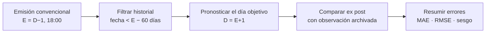
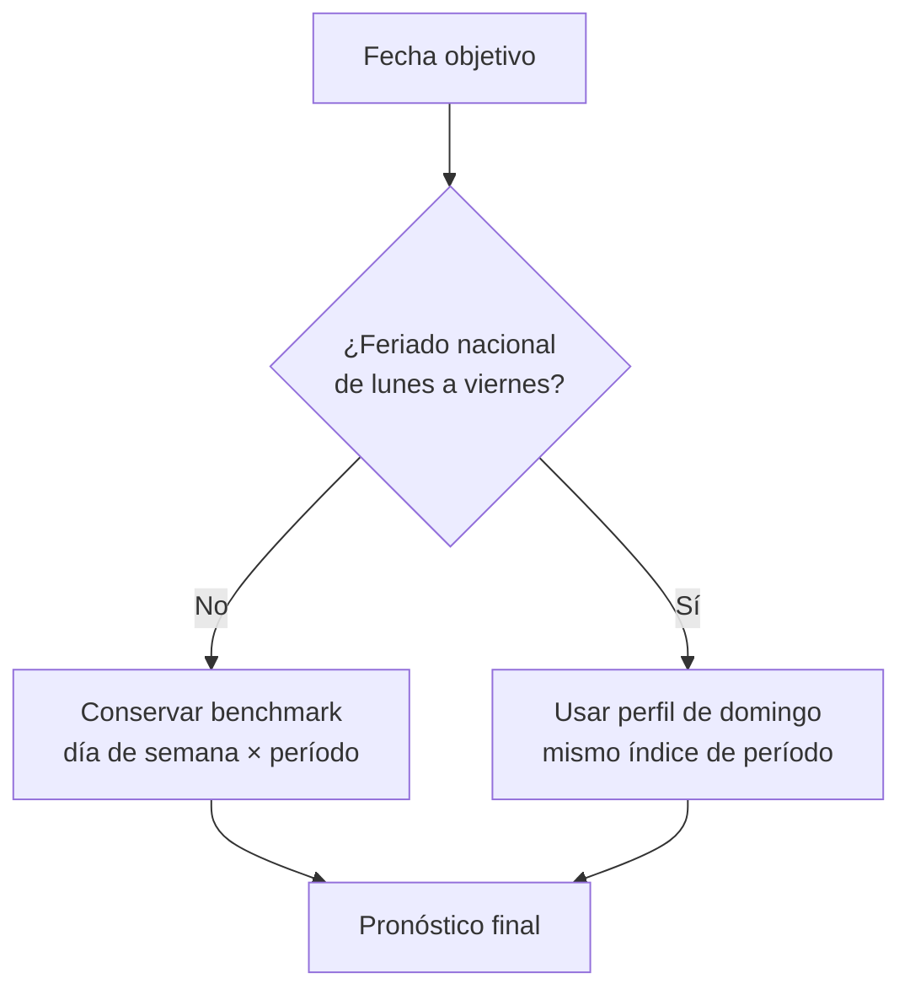
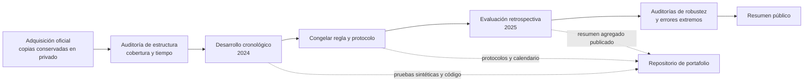

# Caso de estudio: pronóstico de demanda del SEN

En este caso de estudio presento la pregunta, el protocolo y los hallazgos principales. No incluyo observaciones horarias del Coordinador Eléctrico Nacional (CEN), pares de observación y pronóstico ni archivos que permitan reconstruirlos.

## Pregunta

La pregunta que orientó el trabajo fue si una regla sencilla de calendario podía mejorar una referencia estadística para pronosticar los períodos de demanda sistémica agregada del día calendario siguiente.

## Diseño de evaluación

Fijé una emisión diaria a las 18:00 de Chile continental como convención experimental. El objetivo son los períodos que la fuente asigna al día calendario siguiente. Conservé la fecha y el índice horario original; no los convertí a hora civil ni rellené períodos en los cambios de hora.

Para el escenario principal, definí `E` como la fecha local de emisión y `D` como la fecha objetivo: `E = D − 1`. El corte exige `fecha_observacion < E − 60 días calendario`. Lo elegí porque no puedo reconstruir la disponibilidad histórica ni qué versión exacta de cada valor se habría conocido en cada emisión.

Separé cronológicamente el desarrollo y la evaluación. El benchmark de 2025 utiliza un conjunto fijo de datos de 2024, elegibles hasta el 31 de octubre; no incorporé observaciones de 2025 para actualizarlo.

## Métodos comparados

### Benchmark semanal

Definí el benchmark como una media histórica para cada combinación de día de semana e índice de período. Para grupos sin soporte suficiente, apliqué la jerarquía de respaldo fijada en el protocolo. Esa fue la referencia para comparar extensiones.

### Extensión para feriados

Probé una regla de sustitución para feriados nacionales de lunes a viernes: usé el perfil histórico de domingo del mismo índice de período. En las demás fechas se conserva el pronóstico del benchmark. La regla no estima un efecto causal del feriado.

## Resultado agregado publicado

En la evaluación retrospectiva de 2025, ambos métodos cubrieron 8.760 períodos. Estos son los resultados agregados publicados:

| Método | MAE |
| --- | ---: |
| Benchmark semanal | 488,96 |
| Benchmark + perfil de feriados | 479,91 |
| Cambio observado | −1,85 % |

La regla modificó 288 períodos de doce feriados hábiles: en nueve fechas el error mejoró y en tres empeoró. La mejora observada corresponde a ese año; no permite afirmar que se mantendrá en años futuros.

Durante el desarrollo de 2024 probé Ridge y árboles potenciados. Ninguna de las especificaciones ensayadas superó al benchmark en la ventana de validación, así que no las evalué en 2025. Sus cifras no son comparaciones fuera de muestra.

### Desarrollo 2024: métodos probados

| Método | MAE de desarrollo 2024 | Estado |
| --- | ---: | --- |
| Benchmark semanal | 447,16 | Referencia |
| Ridge estacional | 683,16 | No superó al benchmark; no evaluado en 2025 |
| Árboles potenciados | 567,48 | No superaron al benchmark; no evaluados en 2025 |
| Benchmark + perfil de feriados | 421,05 | Extensión seleccionada para una evaluación única en 2025 |

Estas cifras corresponden a la formulación y selección de métodos con los datos de desarrollo de 2024. No son estimaciones independientes del rendimiento futuro.

### Evaluación 2025: métricas agregadas

| Métrica | Benchmark semanal | Extensión de feriados |
| --- | ---: | ---: |
| MAE | 488,96 | 479,91 |
| RMSE | 692,79 | 680,59 |
| Sesgo (`pronóstico − observado`) | −8,87 | −36,37 |
| Períodos evaluados | 8.760 | 8.760 |

En la comparación bajaron el MAE y el RMSE, pero el sesgo se hizo más negativo: aumentó la subestimación neta. La escala numérica se conserva tal como la entrega la fuente, sin atribuirle una unidad física no conciliada.

### Resultado por feriado

| Resultado diario agregado | Fechas de 2025 |
| --- | --- |
| Mejora frente al benchmark (9) | 1 ene.; 18 abr.; 1 may.; 21 may.; 15 ago.; 18 sep.; 19 sep.; 31 oct.; 25 dic. |
| Empeora frente al benchmark (3) | 20 jun.; 16 jul.; 8 dic. |

La regla se aplicó a esas fechas completas y las métricas se calcularon sobre sus períodos horarios. La tabla muestra la dirección agregada por fecha, sin exponer perfiles horarios ni pares de valores observados y predichos.

## Qué muestran las auditorías de errores

- El beneficio se concentra en pocas fechas. La mejora global persistió al retirar un feriado a la vez y al excluir descriptivamente Fiestas Patrias; en este último escenario, la reducción observada fue de 1,00 %.
- Al excluir el 25 y 26 de febrero, la mejora del MAE fue de 1,92 %. Es una sensibilidad sobre el mismo año, no una segunda evaluación independiente.
- El intervalo percentil descriptivo del bootstrap por bloques de siete días incluye cero. Describe sensibilidad al remuestreo de este año; no estima el rendimiento esperado en años futuros.
- La regla solo modifica fechas feriadas; el resto del calendario queda intacto.
- La ventana del 25–26 de febrero contiene 48 de 8.760 períodos (0,55 %) y concentra el 22,73 % de la suma anual de errores cuadrados del benchmark. Los dos métodos produjeron las mismas predicciones en esas fechas.
- El error máximo absoluto registrado fue 10.662,91 en el período 17 del 25 de febrero, en la escala numérica original de la fuente. No se publican la observación ni la predicción de ese período. La coincidencia temporal con un evento excepcional no prueba que este explique por sí solo toda la desviación.

La regla de feriados no está diseñada para anticipar ni corregir perturbaciones extraordinarias. Tampoco se publican curvas horarias reales ni se infieren causas a partir de estos errores.

Estos hallazgos describen una evaluación anual; no prueban confiabilidad operacional.

## Flujo de trabajo y frontera de datos

En el repositorio público comparto código, protocolos, pruebas sintéticas y una aplicación demostrativa sintética. **No incluyo** las series horarias originales, las respuestas originales de API, los archivos de evaluación por observación ni las curvas reales. El dashboard no lee archivos privados ni consulta la API.

La presentación tiene dos partes: este caso resume los resultados históricos agregados y sus límites; el [laboratorio Streamlit](../dashboard/README.md) permite explorar la interfaz con datos ficticios. No se pueden descargar observaciones reales.

Las métricas agregadas se presentan con atribución a la fuente. Esto no constituye una autorización del CEN para redistribuir datos ni resuelve la incertidumbre sobre las condiciones aplicables a resultados derivados. Se conserva la magnitud numérica de la fuente, sin atribuirle una unidad física no conciliada.

## Límites de interpretación

1. La evaluación es retrospectiva: usé valores descargados posteriormente y no reconstruí las revisiones disponibles en cada emisión.
2. Ya conocía el MAE del benchmark de 2025 antes de evaluar la extensión. Por eso, el año no fue un holdout completamente ciego para mi proyecto.
3. Solo se evaluó la extensión en un año; no hay evidencia de estabilidad interanual.
4. No fijé un umbral de error aceptable para decisiones operativas. La mejora relativa del MAE no certifica utilidad ni confiabilidad operacional.
5. La reproducción numérica completa requiere acceso legítimo a los datos fuente y artefactos que no están distribuidos en este repositorio.

## Recursos del repositorio

- [Ejecución de integración continua](https://github.com/LucasMoncadaCL/pronostico-demanda-sen/actions/runs/40407140830): comprobaciones públicas satisfactorias en el commit `b43fcb1`. CI verifica el paquete y sus pruebas sintéticas; no vuelve a ejecutar ni valida numéricamente la evaluación histórica.
- [Protocolo de evaluación v1.2](protocol/protocolo-evaluacion-v1.2.md)
- [Especificación de la extensión de feriados](protocol/experimento-4.5-feriados-habiles-perfil-domingo.md)
- [Dashboard público sintético](../dashboard/README.md)
- [Procedencia y política de datos](../data/README.md)
